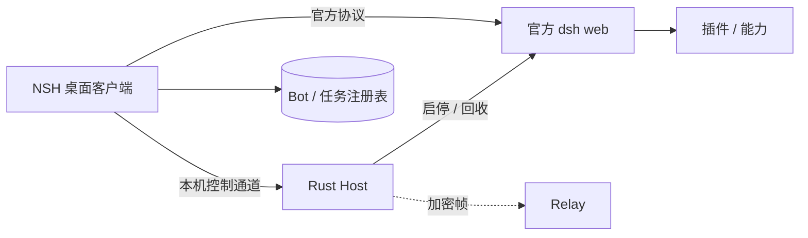

# MyAid 架构（空壳）

本文描述仓库形状；产品规则与实施细节待蓝图补全。布局镜像本机参考仓库 `~/Code/dsh-bot`，**不含业务实现**。

## 系统概览（目标形状）

## 仓库组件

| 位置 | 职责 | 空壳状态 |
| --- | --- | --- |
| `apps/client` | NSH mixed：TSX 入口 + `src/lib.rs` `#[native_module]` | 对齐 `nsh init --template mixed` |
| `apps/host` | dsh 生命周期、HostControl、后续 Bridge | 模块骨架，`serve` 返回未实现 |
| `apps/relay` | 多端密文转发 | 可编译的空 crate |
| `packages/myaid-plugin-*` | Cordis 能力插件 | `myaid-plugin-core` 占位 |
| `scripts` | prepare / dev / check / package | 工作流入口已对齐 |
| `references` | 上游 submodule | 见 `.gitmodules` |

数据根约定：`~/.myaid`。Bun 管理 JS workspace；Cargo workspace 成员为 `apps/client`、`apps/host`、`apps/relay`。
