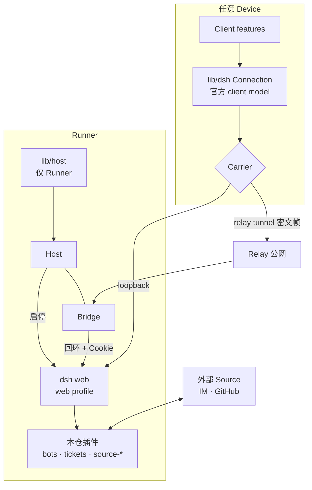

# dsh-bot 架构

dsh-bot 是一个覆盖全端的 Personal Agent：Runner 上的官方 `dsh web` 执行所有工作，本仓的 dsh 插件提供产品能力，NSH Client 在每台 Device 上提供界面。用词见 [GLOSSARY](GLOSSARY.md)，难以撤销的选择及原因见 [decisions/](decisions/)，各机制的细节见文末 Subjects。

## Stack

| 部分         | 技术                                                    | 说明                                                                                                        |
| ------------ | ------------------------------------------------------- | ----------------------------------------------------------------------------------------------------------- |
| 执行         | 官方 `dsh web`（`web` profile），版本见下文「跟随 dsh」 | 唯一后端（[0001](decisions/0001-dsh-web-is-the-only-backend.md)）                                           |
| 产品能力     | dsh 插件：TypeScript、Cordis bundle、Remote             | `packages/*`                                                                                                |
| Client       | NSH 0.6 纯 TSX 加 shadcn-nsh                            | 一份代码覆盖 macOS、Windows、Linux、iOS、Android 和 web（[0007](decisions/0007-the-client-is-pure-tsx.md)） |
| Host / Relay | Rust（Cargo workspace）                                 | Host 跑在 Runner 上，Relay 是公网服务                                                                       |
| 工具链       | bun（唯一 `bun.lock`）加 Vite+（`vp`）；Cargo           | `check` / `test` 见根 `package.json`                                                                        |

## Layers



依赖只沿箭头方向：

- **Client**：`features/*` → `lib/*`，反过来不行。视图只读产品投影，不直接碰传输；投影也不重复计算官方 client model 已经维护的状态。
- **lib/dsh** 只通过 Carrier 访问 dsh web，不知道自己走的是 loopback 还是 relay。`lib/host` 只在 Runner 上装载。
- **Host** 只管进程和连接：dsh web 的生命周期、本机控制面、OS 登记和 Bridge。它不调用任何业务 Remote，Bridge 只负责鉴权之后的转发。
- **Relay** 只负责配对会合和转发密文帧，不解密，也不含业务逻辑。配对和转发尚未实现，目前只有 `serve`、`GET /` 和 `GET /v1/health`。
- **插件**只依赖 dsh 的公开服务（`ctx.get`），插件之间只通过声明的服务互相调用。Source 插件依赖 `tickets` 提供的 `sources` 服务。

## Layout

```text
apps/
  client/            NSH Client（所有平台）
    features/        产品功能，每个目录对应一个术语：bots · dialogue · tickets · devices · settings · workspace
    components/      ui/（shadcn-nsh 复制件，只能用它的 CLI 添加）· app/（产品组合）· shell/（Navigator、Workbench、命令表）
    lib/             dsh/（Connection）· carrier/（loopback · relay）· host/（仅 Runner：控制面、launcher）· i18n/
    screens/         open(…) 入口、截图和真 Host 冒烟
  host/              Rust：dsh_process/ · local_api/ · service/（OS 登记）· bridge/（Relay 链路、配对、转发）
  relay/             Rust：配对会合、密文帧转发
packages/
  bots/              Registry 和 Main Bot（Remote `bots`）
  tickets/           Ticket、Attention、Source 注册面（Remote `tickets`，服务 `sources`）
  source-<kind>/     一个 Source 一个插件，例如 source-feishu、source-github
  dsh-web-protocol/  只给 Client 用的官方 Remote 类型再导出，插件不能依赖它
scripts/             根编排：dev.mjs（唯一的 dev 入口）、dsh 版本检查、文档检查
docs/                GLOSSARY · ARCHITECTURE · architecture/ · decisions/ · specs/ · agents/
references/          只读的上游源码，不参与构建
```

文件夹和文件用术语表里的词命名，不设 `utils/`、`common/` 之类的杂物目录。每个单元的职责和命令写在它自己的 README 里。

## Seams

| Seam            | 接口                                                                                 | Adapters                                                                                 |
| --------------- | ------------------------------------------------------------------------------------ | ---------------------------------------------------------------------------------------- |
| Carrier         | 给官方 `installConnection` 注入的 `fetch` 和 `createWebSocket`，外加 `streamBaseUrl` | `loopback`（Runner 上的 Client，用 Cookie 直连）· `relay`（其他 Device，端到端加密隧道） |
| Source          | `sources` 服务：注册一种 Source，交付 Trigger，经 Channel 写回                       | `source-feishu` · `source-github` · 测试用 fake                                          |
| OS 登记         | Host 的 `service` 模块：生成并执行登记计划                                           | launchd · systemd · Windows Run 键加监督器 · 测试只生成快照                              |
| dsh 子进程      | Host 的 `ChildHandle`                                                                | 真实进程 · 测试用 fake                                                                   |
| Device 偏好存储 | Client 偏好的读写                                                                    | 桌面写数据根下的文件 · 移动端和 web 用 NSH Storage                                       |

## 数据归属

| 数据                                         | 归谁                                               | 访问方式                                                                      |
| -------------------------------------------- | -------------------------------------------------- | ----------------------------------------------------------------------------- |
| Session、Workspace、设置、凭据、Agent preset | dsh                                                | 官方 Remote 和 client model（`ctx.sessions` / `ctx.workspaces`）              |
| Registry、Main Bot                           | `bots` 插件，存在 `$DSH_BOT_HOME`                  | `bots` Remote（[0004](decisions/0004-the-registry-lives-in-a-dsh-plugin.md)） |
| Ticket、Attention、Source 配置和读取位置     | `tickets` 和 `source-*` 插件，存在 `$DSH_BOT_HOME` | `tickets` Remote                                                              |
| 配对的公钥                                   | Host 的 Bridge，存在数据根下                       | Runner 上的本机控制面                                                         |
| Pin、Pane 布局、主题、语言                   | 各 Device 自己                                     | Device 偏好存储                                                               |

Runner 的数据根是 `$DSH_BOT_HOME`（默认 `~/.dsh-bot`）。Host 启动 dsh web 时把它作为 dsh 的 `DSH_HOME` 传入，所以 dsh 和本仓插件的数据都在这里；`DSH_HOME` 只出现在这一个交接点，本仓其余文档和代码都用 `DSH_BOT_HOME`。隔离开发用 `~/.dsh-bot-dev/<name>`。

## 跟随 dsh

dsh 的版本只写在三个地方：根 `package.json` 的 `workspaces.catalog`（所有 `@deepseek-ai/*`）、`apps/host/supported-dsh.json`（编译进 Host）、`references/deepseek-harness` 子模块的 `dsh-v<version>` tag。`scripts/check-dsh-pin.mjs` 是 `bun run check` 的第一步，负责检查三者一致、各包都写 `"catalog:"`，以及插件的 `engines.dsh` 包含这个版本。升级时只改这三处，然后 `bun install && bun run check`。

## 平台

| 角色   | 平台                           | 连接方式                                      |
| ------ | ------------------------------ | --------------------------------------------- |
| Runner | macOS · Windows · Linux 桌面   | Client 走 loopback，并通过 launcher 管理 Host |
| Device | iOS · Android · 其他桌面 · web | relay tunnel，第一次使用前要先配对            |

## Subjects

| 文档                                             | 主题                                                          |
| ------------------------------------------------ | ------------------------------------------------------------- |
| [dsh-connection](architecture/dsh-connection.md) | Client 怎样认证并连到 dsh web：Cookie、mux、能力授权、Carrier |
