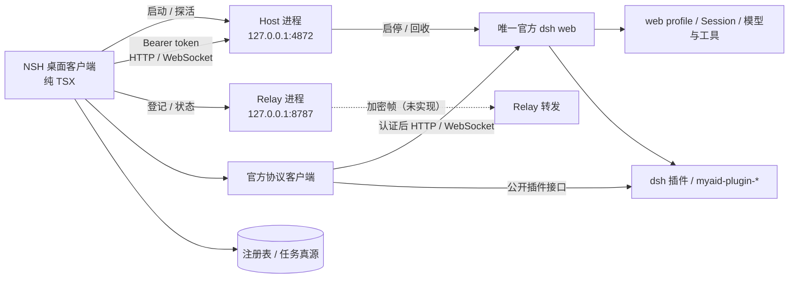

# MyAid 架构

本文是技术方案真源：进程边界、Host、插件与数据归属继承 [DSH 原则](DSH_PRINCIPLES.md)。产品规则见 [BLUEPRINT.md](BLUEPRINT.md)，概念见 [GLOSSARY.md](../GLOSSARY.md)。Host / Relay / 插件与成品打包仍多为骨架；**不以文档追认未完成代码**。

## 1. 系统概览



实线为单机目标形状；虚线为多端。系统边界：

1. 官方 `dsh web` + `web` profile 承载全部执行；产品经声明式 bundle 使用官方或 `packages/myaid-plugin-*`。
2. Rust Host 独占 dsh 生命周期与连接发现（照 lorca 的 `lorca serve`，见 [ADR 0007](adr/0007-native-layer-after-lorca.md)）；Client 直连官方协议做业务。
3. 桌面持有注册表与交互状态；dsh 持有 Session、执行状态、共享设置与凭据。
4. **不设 `ProductService`**；本机控制面只做宿主管理与登记事实，不是业务网关。
5. 关闭 UI 停止 App 自己启动的 Host 子进程；OS 登记的那份 Host / Relay 由 launchd、systemd 或 Windows 监督器常驻，显式停止才清理。

## 2. 仓库与组件

| 位置                      | 职责                                                                      | 现状                                                                                     |
| ------------------------- | ------------------------------------------------------------------------- | ---------------------------------------------------------------------------------------- |
| `apps/client`             | NSH **TSX**：产品 UI / 注册表 / 官方协议 / 回环控制面客户端               | AppShell；Bot → Dialogue → Session；Settings ⇄ Background Services                       |
| `apps/host`               | dsh 生命周期、回环控制 API、OS 登记、后续 Bridge                          | Lifecycle + `local_api`（HTTP/WS）+ `service` 已落地；Bridge 空壳                        |
| `apps/relay`              | 常驻 Relay 进程、本机控制 API、OS 登记；多端密文转发（后）                | `config` / `routes` / `run` / `service` 已落地；转发面与身份仍骨架                       |
| `crates/myaid-service`    | 两个单元逐字相同的 launchd / systemd / Windows 计划与登记动词（ADR 0007） | plist、systemd 单元、Run 键与监督器                                                      |
| `packages/myaid-plugin-*` | Cordis 能力插件；约束见 [AGENTS](../packages/AGENTS.md)                   | `myaid-plugin-core` 空壳；`myaid-plugin-bot-presets` 提供 Bot 派生 preset 写入口         |
| 根 `package.json`         | bun workspace；任务经 **Vite+ `vp run`** 调度                             | `bun run dev` → `scripts/dev.mjs`（构建 Host 后起 Client，Host 由 App 启动）；`host:dev` |
| `references`              | 只读上游：`nsh`（示例 UI）、`deepseek-harness`（dsh 能力面）              | `.gitmodules`；不参与构建                                                                |

Bun 管理 JS workspace 与唯一 `bun.lock`；Cargo workspace：`apps/host`、`apps/relay`、`crates/myaid-service`。不在 Rust 中重实现 Harness，也不在 Client 里放 Rust：Client 用标准 `fetch` / `WebSocket` 调宿主与转发。

## 3. 装配与启动

```sh
# App 启动器会做的事：显式起一份 Host（产品数据根、钉住的 dsh）
myaid-host serve-app --port 4872 --ready-stdout
# 隔离/开发入口
myaid-host serve --data-root "$SCRATCH" --port 4873 --official-dsh --ready-stdout
# Host 自己拉起的官方 dsh
DSH_HOME=~/.myaid /absolute/path/to/dsh web --host 127.0.0.1 --port 0 --no-open
```

### Host 模块

```text
apps/host/src/
├── main.rs           # serve-app | serve | guardian | service …
├── lib.rs
├── config.rs / runtime.rs
├── local_api/        # mod + routes + auth + status（回环 HTTP / WebSocket 控制面）
├── service.rs        # 本单元的 OS 登记（launchd / systemd / Run 键）
├── dsh_process/      # Lifecycle 公开入口；内部 ProcessState + ChildHandle seam
└── bridge/           # 多端阶段
```

| Module                     | 原则                                                                                                                   |
| -------------------------- | ---------------------------------------------------------------------------------------------------------------------- |
| `DshProcess` / `Lifecycle` | 独占 CLI、环境、spawn、ready、版本、日志、回收与并发启动归并；内部 `ProcessState`，seam 上映射公开 status / connection |
| `local_api`                | `127.0.0.1:<port>` 的 HTTP 路由与 `/watch` 订阅；`Origin`/`Host` 校验 + Bearer token；只调 `Lifecycle` 与 `service`    |
| `service`                  | 本单元在 OS 上的登记（plist / 单元 / Run 键与监督器），计划是 `crates/myaid-service` 的纯函数，测试只快照不安装        |
| `Bridge`                   | 配对、授权、官方协议转发                                                                                               |

相位（与 `local_api/status.rs` 一致）：`stopped → preparing → starting → ready`；另有 `recovering`；失败 `failed`；停止 `stopping → stopped`。新子进程新 `generation`。ready ≠ 端口可连；官方客户端认证后才允许业务。公开 status 不含认证 URL/token（`GET /connection` 单独给，且只在 ready）。ready-URL / 相位校验真源：`parse_ready_url` + `Status::validate`（fixture：`apps/host/testdata/host-contract-cases.json`）。

初始化分工：NSH 管注册表 / 草稿 / Dialogue 指向哪个 Workspace；Host 管数据根、CLI、登录环境、profile 首启；dsh Workspace 拥有 path、title、Session 顺序、置顶与归档。缺 CLI、版本不符或目录不可写须返回明确原因，保留用户内容。

## 4. Cordis / 插件装配

- 产品插件：`packages/myaid-plugin-*`，含 `cordis.patch.yml` 与 `package.json` 的 `dsh.bundle`。
- 经官方 `dsh plugin add` 或 Host/开发期 `--patch` 指向绝对 `lib/index.js`。
- NSH 调用公开 Remote；专属数据在 `$DSH_HOME` 下由插件管理。Bot 派生 preset 的写入口归 [`myaid-plugin-bot-presets`](../packages/myaid-plugin-bot-presets/README.md)；执行组合仍经官方 registry 注册。
- 参考：`docs/research/HARNESS_PRINCIPLES.md`。

已知缺口与候选插件：

| 缺口                              | 候选                                               | 影响                                   |
| --------------------------------- | -------------------------------------------------- | -------------------------------------- |
| Bot identity 只在本机             | `myaid-plugin-bot-identity`（或 session metadata） | identity 不能跨设备同步                |
| 审批没有 “Always allow”           | approval-policy 插件                               | 每次审批都要人点                       |
| prompt receipt 不带 queue item id | 向 dsh 提需求                                      | Withdraw 依赖 `inbox` 投影回报 item id |

Known limitations：NSH 标准 websocket 在 8 条未读消息时暂停读取；dsh mux 连续 2 次未收到 pong（2 s 心跳）即断开。重连已全部归官方 client model（每代 generation 原子替换窗口），产品侧不再自建退避重跟。实测与细节在 [DSH_CLIENT_AUTH](DSH_CLIENT_AUTH.md)。

## 5. 客户端（NSH TSX）

```text
apps/client/
├── App.tsx / App.test.tsx      # mount AppShell
├── components/
│   ├── shell/                  # Workspace Shell：Navigator + Workbench + Panels、命令表、偏好、注意
│   └── ui/                     # 样式化基础层（唯一包装 nsh/base）
├── features/
│   ├── bots/                   # 注册表模型 / store / identity / Bot Panel 与 Bot Settings
│   ├── dialogue/               # chat、session 运行时、Dialogue / Session Panel
│   ├── workspace/              # 官方 Workspace 模型的产品投影、v4→v5 迁移与 workspace.* 命令
│   ├── inspector/              # Session Panel 的右侧窄栏
│   └── settings/               # Background Services 面板（ADR 0002）
├── lib/
│   ├── dsh/                    # Cookie + 标准 WebSocket、Connection、官方 client model 装配
│   ├── host/                   # 控制面客户端（client.ts）、启动器（launcher.ts）、登记动词
│   ├── relay/                  # Relay 登记动词
│   └── background/             # 两个 Background Service 的产品编排
├── screens/                    # open(…) 入口、截图与真 Host 冒烟（opt-in）
└── nsh.json                    # 纯 TSX：无 "rust" 键；network / process 能力收窄
```

### 原生层（ADR 0007）

- 应用不再带 Rust：控制面是 `lib/host/client.ts` 的 `fetch` + 标准 `WebSocket`，token 取自 `<数据根>/host/serve-token`（Relay 用 `relay/serve-token`）。
- `lib/host/launcher.ts` 是 lorca 的 launcher：探 `/` → 复用或 spawn `myaid-host serve-app` → 退出后退避重启（1s 起、翻倍到 15s）→ 失败时由页脚给空状态与手动命令。启动器拿到的 `MYAID_HOST_PORT` / `MYAID_DATA_ROOT` 与客户端读 token 的根是同一套。
- 页脚订阅启动器的相位：Host 退出时 Client 丢弃当前 Connection 并从新 Host 重建（dsh 自己会一直重试旧登录 URL，不能作为信号）。
- `nsh.json` 的 `network` 只授予回环 `/`、`/status`、`/connection`、`/watch`、`/dsh/*`、`/registration*`、Relay 的 `/v1/health` 与 dsh 的 `/connect`、`/api/*`；`process.execute` 只授予 `myaid-host`。

- **壳**：`AppShell` 挂 `components/shell`；左 Navigator 是注册表 / roster / Favorites / Settings 的投影树，右 Workbench 是按 Nav address 挂内容的 DockArea。Panel 只持地址，内容由 `features/*` 提供。
- **数据归属**：注册表（Bot、Dialogue 的 `botId` + `workspaceId`、Claim）与客户端偏好是桌面盘上的真源（`~/.myaid/registry/bots.json`、`~/.myaid/prefs/client.json`；web / 移动走 NSH Storage）。dsh 的真源经官方 client model 到达 Client：Workspace 的 path / title / Session 顺序 / 置顶 / 归档由 `ctx.workspaces`（`ClientWorkspaceModel`）拥有，Session 列表、事件窗口、follow、分页、prompt/queue/control 与投影由 `ctx.sessions`（`ClientSessions → SessionManager → Session`）拥有；产品只投影它们的 snapshot（[`features/workspace`](../apps/client/features/workspace/state.ts)、[`features/dialogue/session`](../apps/client/features/dialogue/session/controller.ts)）。Bot identity 归注册表（[ADR 0003](adr/0003-bot-identity-is-local-registry-data.md)），Dialogue 名与归档归 dsh（[ADR 0005](adr/0005-dialogue-on-dsh-workspace.md)）。
- **三层分工**：官方 client model（本地真相镜像：对象 identity、流与一元竞态、重连）→ 产品投影（`TurnProjection` / `rows.ts` / `WorkspaceProjection`：把官方窗口与 snapshot 变成 Dialogue 消息、列表行、Navigator 状态）→ NSH 视图（`features/*` 的 Panel 与 `components/ui`）。视图不读 transport，投影不重算官方 model 已拥有的状态。
- **命令与注意**：`components/shell/commands.ts` 是唯一命令表，同时喂应用菜单、`⌘K` 与快捷键；`components/shell/attention.ts` 比较 roster 两帧，决定系统通知与 Dock badge。
- **dsh 客户端**：`lib/dsh/connection.ts` 建一条 Client generation：挂官方 Remote、在同一条 Cordis Context 上装官方 client model（`ctx.sessions` / `ctx.workspaces` / 文件上传服务），并保留官方未提供的命令（模型目录与选择、skills、`/command`、插件清单、bot preset、目录选择、上传）。Cookie 换票与 mux 见 [DSH_CLIENT_AUTH](DSH_CLIENT_AUTH.md)。`lib/dsh/sdk.ts` 是 Node 条件入口源，`prepare:sdk` 产出 `sdk.js` 与 `generated/*`（官方 ModuleLoader client 包的静态展开）。
- **Background**：`lib/background` 只编排 Host 与 Relay 的登记意图；Settings ⇢ Background Services 显示两单元事实并发出 query / enable / stop。事实来自两个进程各自的控制面（`lib/host/registration.ts`、`lib/relay/registration.ts`）；Relay 没在跑只显示为未登记 + 原因，不拖垮 Host 那半。
- **数据与能力**：文件读写只授应用自己的数据（[ADR 0004](adr/0004-client-fs-limited-to-app-data.md)）；HTTP / WebSocket 按 `nsh.json` `capabilities.network` 收窄，进程只授 `myaid-host`。

保持 NSH 生成时的目录形状（[project structure](https://nsh.dev/docs/project-structure.md)）；应用本身是纯 TSX（[ADR 0007](adr/0007-native-layer-after-lorca.md)）。**不要**另起独立 `frontend/` 树。单元契约见 [apps/client/README.md](../apps/client/README.md)，编码护栏见 [apps/client/AGENTS.md](../apps/client/AGENTS.md)。

## 6. 本机控制面（原则）

- 形状照 lorca：`127.0.0.1` 上的 HTTP + 一个 WebSocket；见 [ADR 0007](adr/0007-native-layer-after-lorca.md) 与 `apps/host/src/local_api/`。
- 路由：`GET /`（探活文本 `myaid`）、`GET /status`、`GET /connection`、`GET /watch`（WS）、`POST /dsh/start|stop|restart`、`GET /registration`、`POST /registration/enable|stop`。Relay 同形（`/`、`/v1/health`、`/registration*`）。
- 认证：数据根 `serve-token` 的 Bearer，常量时间比较；`Origin` 存在或 `Host` 不是本端口回环一律 403。`/watch` 另接受查询串 token（标准 WebSocket 不能设头），只推公开状态。
- `POST /dsh/start` 的 `source` 区分 `attach` 与 `userStart`；自动附着不能解除用户停机意图。Host 只报告 Host 单元事实，Relay 相位在 Host 的快照里恒为未登记，由 Client 合并。
- 多端另含配对与设备列表（未实现）。

## 7. Relay

`apps/relay` 是第二个常驻单元（与 Host 对等、存活独立），布局照 lorca 的 `crates/relay`：`config.rs`（`--bind` 语义由 `--port` / `MYAID_RELAY_PORT` 表达）、`routes.rs`（`/`、`/v1/health`、`/registration*`）、`run.rs`（绑定、token、优雅停止）、`service.rs`（本单元 OS 登记）。它用自己的 `serve-token`，不经过 Host。转发面仍只做端到端密文帧；身份密钥、配对与存储随后续移动端一并落地（ADR 0007），不持 owner 凭据，不替代执行侧输入队列。

## 8. 打包与交付（目标）

成品目标：组装 App + Host + Relay，App 从自身资源里带着 Host 二进制（启动器按名字 `myaid-host` 在 PATH 上找，打包时放进 PATH 或资源目录）。OS 登记由两个单元自己写 plist / 单元 / Run 键，测试只用快照计划，真机安装须成品验收——**尚未实现**。客户端侧 `vp run @myaid/client#package:macos` 只产出 NSH `.app`，不是根级成品。
