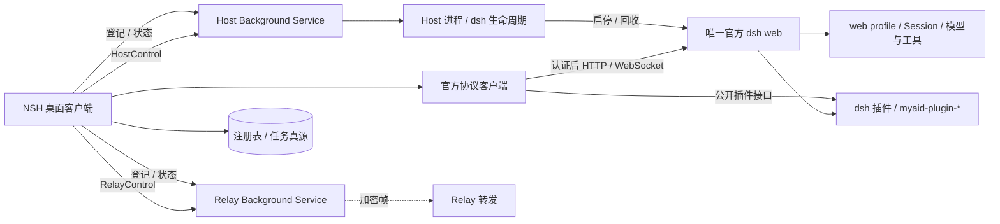

# MyAid 架构

本文是技术方案真源：进程边界、Host、插件与数据归属继承 [DSH 原则](DSH_PRINCIPLES.md)。产品规则见 [BLUEPRINT.md](BLUEPRINT.md)，概念见 [GLOSSARY.md](../GLOSSARY.md)。Host / Relay / 插件与成品打包仍多为骨架；**不以文档追认未完成代码**。

## 1. 系统概览



实线为单机目标形状；虚线为多端。系统边界：

1. 官方 `dsh web` + `web` profile 承载全部执行；产品经声明式 bundle 使用官方或 `packages/myaid-plugin-*`。
2. Rust Host 独占 dsh 生命周期与连接发现；NSH 直连官方协议做业务。
3. 桌面持有注册表与交互状态；dsh 持有 Session、执行状态、共享设置与凭据。
4. **不设 `ProductService`**；HostControl 只做宿主管理，不是业务网关。
5. 关闭 UI 不停止 Host / dsh；显式停止才清理。

## 2. 仓库与组件

| 位置                      | 职责                                                            | 现状                                                                   |
| ------------------------- | --------------------------------------------------------------- | ---------------------------------------------------------------------- |
| `apps/client`             | NSH **mixed**：TSX + 根 Rust crate；产品 UI / 注册表 / 官方协议 | AppShell + Dialogue Session 接线；HostControl 原生适配                 |
| `apps/host`               | dsh 生命周期、HostControl、后续 Bridge                          | Lifecycle + control socket 已落地；Bridge 空壳                         |
| `apps/relay`              | 多端密文转发；约束见 [AGENTS](../apps/relay/AGENTS.md)          | 可编译空 crate                                                         |
| `packages/myaid-plugin-*` | Cordis 能力插件；约束见 [AGENTS](../packages/AGENTS.md)         | `myaid-plugin-core` 占位                                               |
| 根 `package.json`         | bun workspace；任务经 **Vite+ `vp run`** 调度                   | `bun run dev` → `scripts/dev.mjs`（先起 Host 再起 Client）；`host:dev` |
| `references`              | 只读上游：`nsh`（示例 UI）、`deepseek-harness`（dsh 能力面）    | `.gitmodules`；不参与构建                                              |

Bun 管理 JS workspace 与唯一 `bun.lock`；Cargo workspace：`apps/client`、`apps/host`、`apps/relay`。不在 Rust 中重实现 Harness。

## 3. 装配与启动

```sh
DSH_HOME=~/.myaid /absolute/path/to/dsh web --host 127.0.0.1 --port 0 --no-open
```

### Host 模块

```text
apps/host/src/
├── main.rs
├── lib.rs
├── config.rs / runtime.rs
├── host_control/     # mod + protocol（共享控制契约）
├── dsh_process/      # Lifecycle 公开入口；内部 ProcessState + ChildHandle seam
└── bridge/           # 多端阶段
```

| Module                     | 原则                                                                                                                       |
| -------------------------- | -------------------------------------------------------------------------------------------------------------------------- |
| `DshProcess` / `Lifecycle` | 独占 CLI、环境、spawn、ready、版本、日志、回收与并发启动归并；内部 `ProcessState`，seam 上映射公开 status / connectionInfo |
| `HostControl`              | 本机端点（Unix socket / Windows named pipe）、同用户校验、请求分派、状态订阅；只调 `Lifecycle`                             |
| `Bridge`                   | 配对、授权、官方协议转发                                                                                                   |

相位（与 `protocol.rs` 一致）：`stopped → preparing → starting → ready`；另有 `recovering`；失败 `failed`；停止 `stopping → stopped`。新子进程新 `generation`。ready ≠ 端口可连；官方客户端认证后才允许业务。公开 status 不含认证 URL/token。ready-URL / 相位校验真源：`parse_ready_url` + `Status::validate`（fixture：`apps/host/testdata/host-contract-cases.json`）。

初始化分工：NSH 管注册表 / 草稿 / 工作区；Host 管数据根、CLI、登录环境、profile 首启。缺 CLI、版本不符或目录不可写须返回明确原因，保留用户内容。

## 4. Cordis / 插件装配

- 产品插件：`packages/myaid-plugin-*`，含 `cordis.patch.yml` 与 `package.json` 的 `dsh.bundle`。
- 经官方 `dsh plugin add` 或 Host/开发期 `--patch` 指向绝对 `lib/index.js`。
- NSH 调用公开 Remote；专属数据在 `$DSH_HOME` 下由插件管理。
- 参考：`docs/research/HARNESS_PRINCIPLES.md`。

## 5. 客户端（NSH mixed）

```text
apps/client/
├── App.tsx / App.test.tsx
├── components/          # AppShell、导航、ui 基础层
├── features/            # 业务域（如 dialogue）
├── workspace/           # 模块注册与工作台状态
├── lib/dsh/             # Cookie 认证 + AuthenticatedSocket
├── assets/
├── nsh.json             # "rust": "."
├── Cargo.toml / src/    # #[native_module("myaid/native")]；CookieWebSocket 等
```

对齐 `nsh init --template mixed`（[project structure](https://nsh.dev/docs/project-structure.md)）。**不要**另起独立 `frontend/` 树，除非另有决策。细则见 [apps/client/AGENTS.md](../apps/client/AGENTS.md)。

原生缺口（Cookie WebSocket、控制 socket、`SMAppService`）在 `src/` 注册；标准网络仍走 NSH API。

## 6. 本机控制协议（原则）

- 协议版本常量与帧边界见 `apps/host/src/host_control/protocol.rs`。
- 操作语义（目标）：`status` / `watchStatus` / `connectionInfo` / `ensureDsh` / `stopDsh` / `restartDsh`；Background 登记：`registrationQuery` / `registrationEnable` / `registrationStop`（共享契约，Host 只报告 Host 单元事实，Relay 相位在 Host 侧恒为未登记）；多端另含配对与设备列表。
- `ensureDsh` 区分 `attach` 与 `userStart`；自动附着不能解除用户停机意图。

## 7. Relay

`apps/relay` 只做端到端密文帧转发与有界队列；不持 owner 凭据，不替代执行侧输入队列。

## 8. 打包与交付（目标）

成品目标：组装 App + Host + 服务组件；脚本不另管一套 dsh 进程。签名与 `SMAppService` 须成品验收——**尚未实现**。客户端侧 `vp run @myaid/client#package:macos` 只产出 NSH `.app`，不是根级成品。
