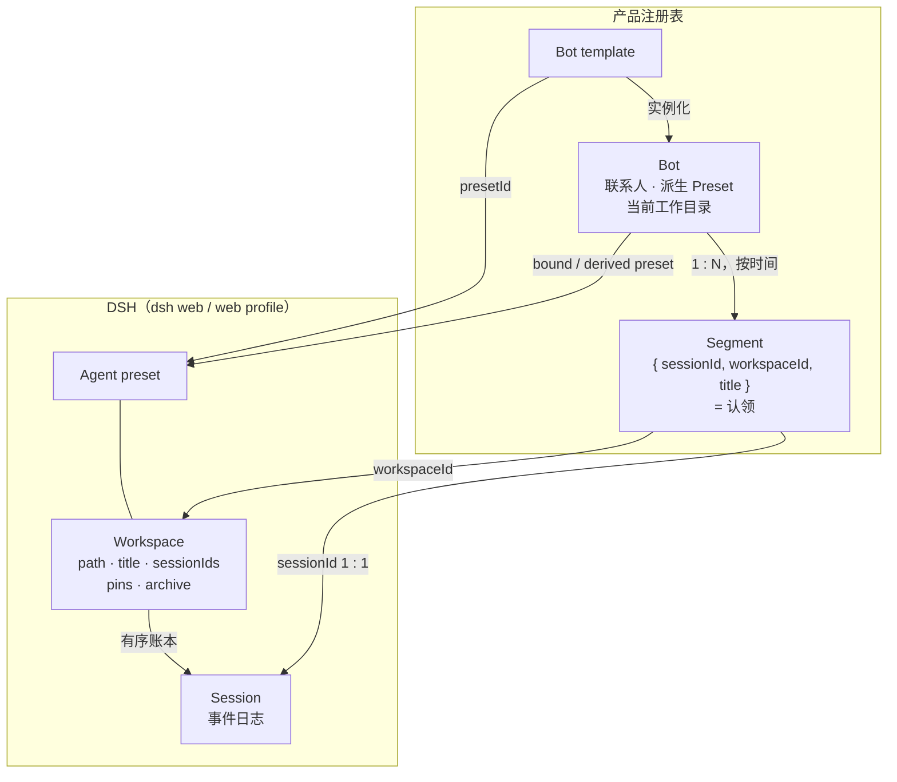
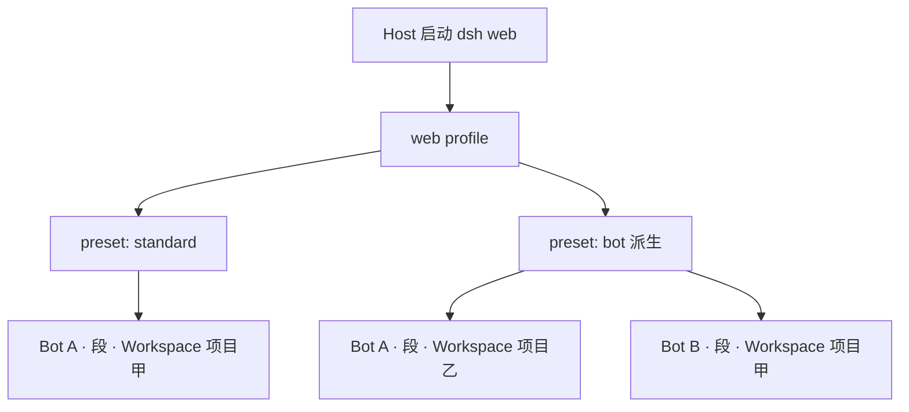
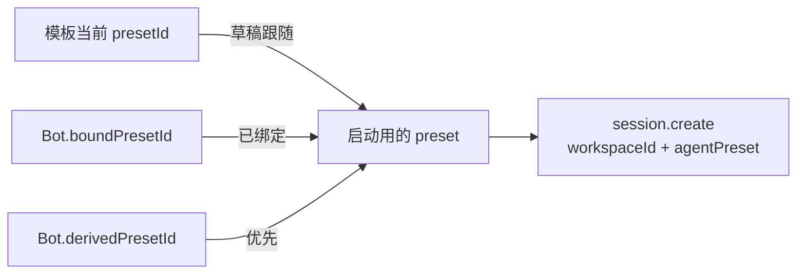
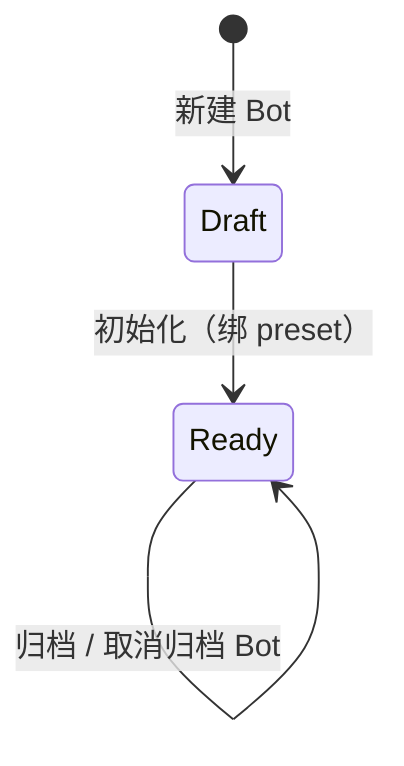
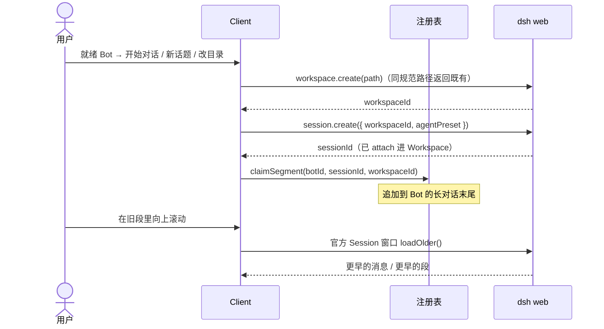
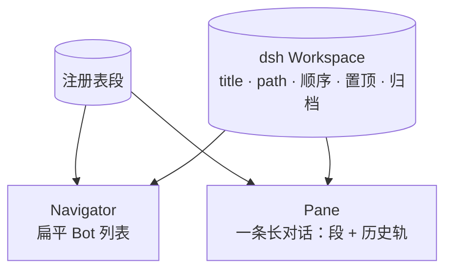

# Bot · 段 · Session · DSH 映射

对象边界与所有权对照。原则见 [BLUEPRINT](BLUEPRINT.md)，决定见 [ADR 0001](adr/0001-bot-has-many-sessions.md)、[ADR 0005](adr/0005-dialogue-on-dsh-workspace.md) 与 [ADR 0006](adr/0006-lorca-style-bot-app.md)，用词见根 [GLOSSARY](../GLOSSARY.md)。

**现状（注册表 v6）**：一个 Bot 只有**一条长对话**，由按时间相连的**段**组成；每段是一条 dsh Session，并记住它跑在哪个 dsh Workspace。段可以跨 Workspace，旧段保留自己的目录。注册表不再有 Dialogue 对象。

## 一图总览

要点：

| 产品         | DSH                              | 关系                                                      |
| ------------ | -------------------------------- | --------------------------------------------------------- |
| Bot template | Agent preset id                  | 模板映射 preset；非正文快照                               |
| Bot          | 共用 `web` profile 上启动 preset | 能力 = preset（`plugins`：指令、工具、skills、可选 MCP…） |
| 段 Segment   | 一条 Harness Session             | 1 : 1；段属于 Bot，并引用它运行的 Workspace               |
| 认领 Claim   | （注册表里的段本身）             | `botId` + `sessionId` + `workspaceId`；日志仍在 dsh       |
| 段标题       | （注册表）                       | 人对该段的称呼；dsh 的 Session 列表不提供标题             |
| Workspace    | dsh Workspace                    | path / title / Session 顺序 / 置顶 / 归档都归 dsh         |
| 当前工作目录 | 最新段的 Workspace path          | 在 Pane 标题处显示与编辑；换目录开新段                    |
| Deliverable  | DSH Deliverable                  | 投影某段场景内的交付物；一条长对话可累积多个              |
| （无）       | 未认领 Session                   | 不进入产品                                                |

基数：**Bot 1—N 段**；**Workspace 1—N 段**（同一目录可以被多个 Bot 的段使用）；**段 1—1 Session**。一个 Bot 的段可以分布在多个 Workspace。

## Profile 与 Preset

|            | **Profile**                         | **Agent preset**                                             |
| ---------- | ----------------------------------- | ------------------------------------------------------------ |
| 是什么     | 一次 `dsh` 进程的装配单元           | 该进程里某个 Agent 的子插件组合（`id` + `plugins`）          |
| MyAid 用法 | 全体 Bot **共用**官方 `web` profile | 每个 Bot 一个 preset id（模板绑定或派生）                    |
| 数量       | 一个本机执行面、一个 profile        | 同一 profile 上可有多个 preset                               |
| 谁持有正文 | profile 装配在 dsh / Host           | profile preset 在 dsh；Bot 派生 preset 在插件；注册表只存 id |

- **不**按 Bot 拆 profile 或 dsh 进程。
- Bot 差异落在 **preset**；目录差异落在**段的 Workspace**。
- 产品口语 **Runner** = 本机 `dsh web` / web profile，**不是** DSH 专名。

## 身份与能力

- 能力、默认模型、默认工作目录属于 **Bot**（preset）。
- **Workspace** 属于 dsh；段只持有 `workspaceId`。`session.create` 用 `workspaceId`（dsh 解析 cwd、建好后 attach），不再传 cwd。
- 改能力：更新派生 preset；正在跑的一轮不打断。派生正文由 `myaid-plugin-bot-presets` 拥有并注册进官方 registry；改完后**新建**的段用新组合，已存在的段保留它已持有的组合。

## 段的生命周期

- **只有最新段接受输入**；旧段可复制、可定位，不在其中续聊。
- **新段**：命令面板「新话题」、输入 `/new`、或在 Pane 标题处改工作目录。
- **Compact** 在同一段内运行，不自动新开段。
- **归档是 Bot 的**；段没有单独的归档 / 删除界面。dsh 里旧 Session 的归档标记不把段从长对话里藏起来；v5 迁移会把它们取消归档，让历史完整。

## 两个视图

- 新建段只挂在某个就绪 Bot 上。
- 未认领 Session 不展示。
- Pane 是一条连续 transcript：段与段之间有「日期 · 工作目录」分隔线；右侧历史轨每段一个刻度，当前段高亮，点击跳到该段开头。
- Bot 没有段时，Pane 提供在默认工作目录开始第一段。

## 真源分工

| 真源       | 持有                                                                                                                 |
| ---------- | -------------------------------------------------------------------------------------------------------------------- |
| dsh        | Session 日志与执行状态、Workspace（path / title / 顺序 / 置顶 / 归档）、preset 正文、凭据、Deliverable 相关事件/摘要 |
| 桌面注册表 | Bot、段的 `sessionId` / `workspaceId` / 标题、模板引用、模型偏好、默认工作目录、Bot 归档位                           |
| 客户端偏好 | Navigator 宽度 / 折叠、Workbench 布局、**Pin 的 Bot 顺序**                                                           |
| 插件       | 派生 preset 正文与技能副本（`myaid-plugin-bot-presets`，`$DSH_HOME`）                                                |
| Host       | dsh 生命周期与连接发现；不写业务段 / Session 权威                                                                    |

## 执行占用（按 Workspace）

同一 **Workspace** 同时只有一条 Session 可执行；其它段可看历史 / 可新建，开始执行须等占用释放。不同 Workspace 的段可以各跑一条。两个 Bot 的段落在同一目录即同一 Workspace，因此它们在该目录上互斥。
