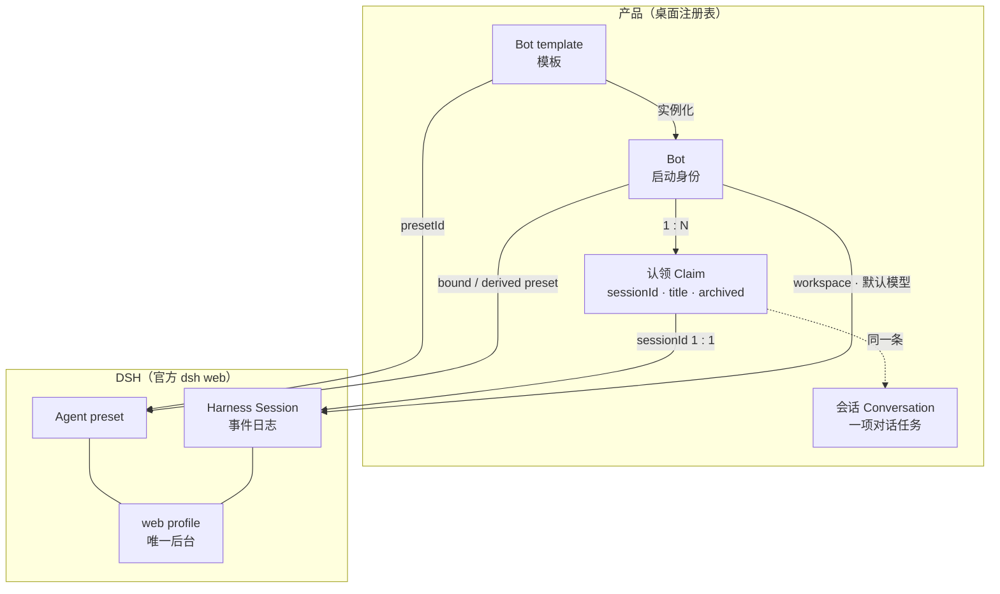
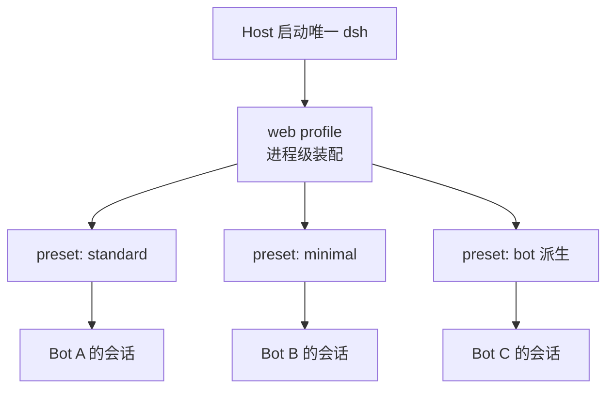
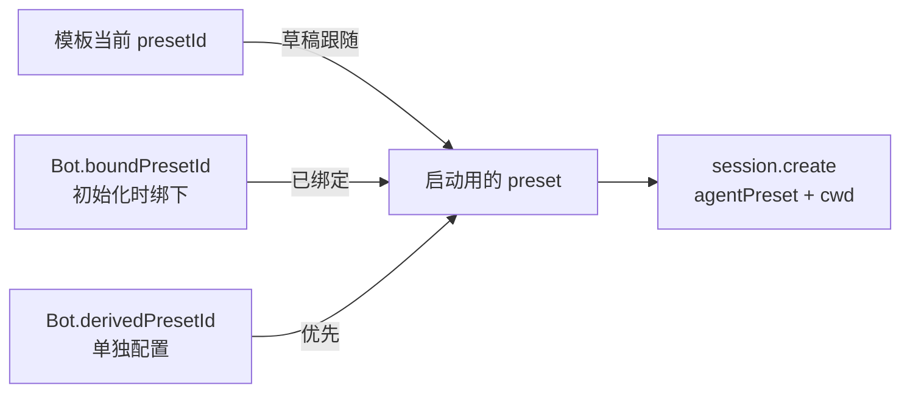
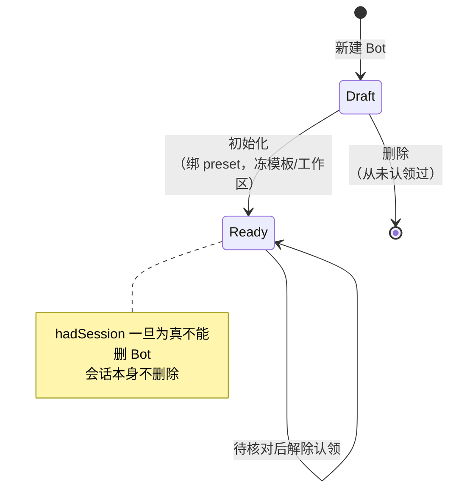
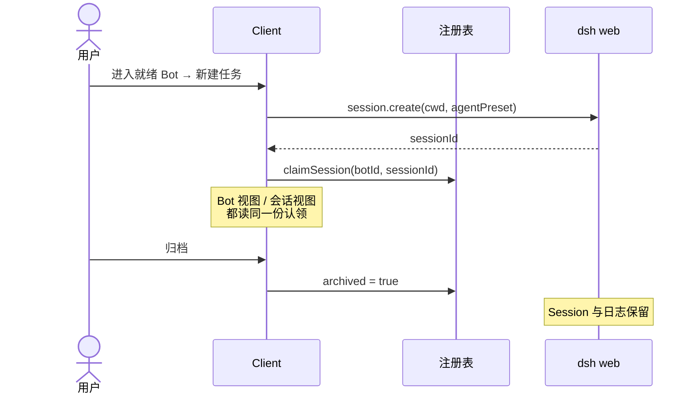
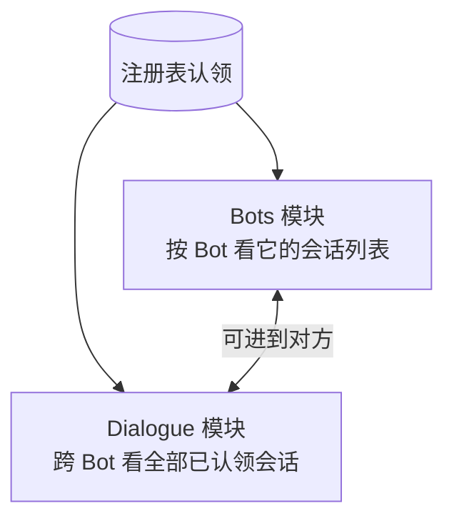
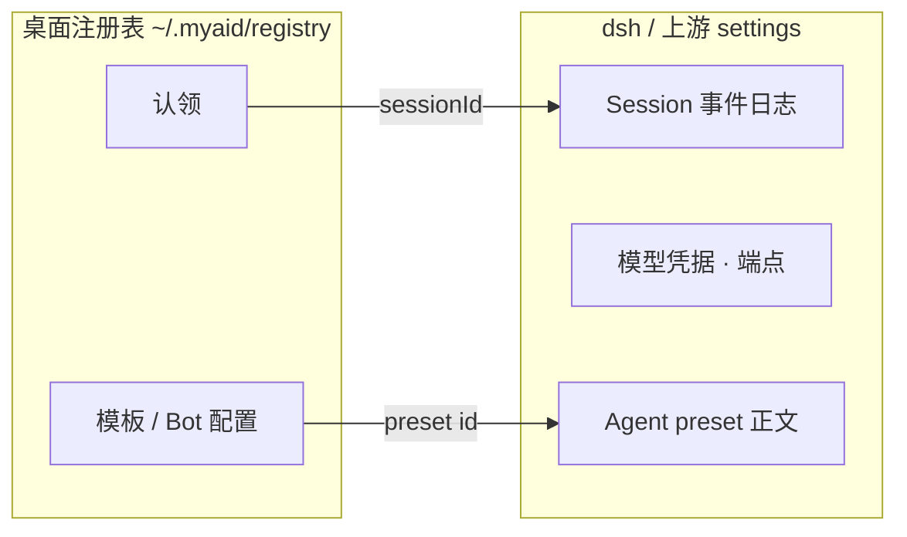
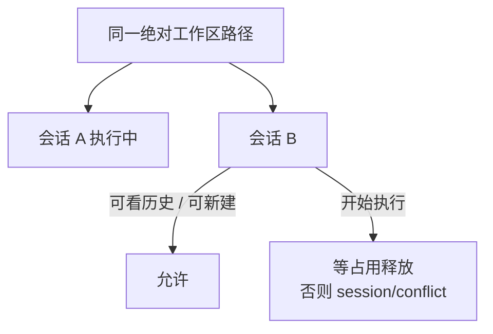

# Bot · 会话 · DSH 映射

对象边界与所有权对照。原则见 [BLUEPRINT](BLUEPRINT.md)，决定见 [ADR 0001](adr/0001-bot-has-many-sessions.md)，用词见根 [GLOSSARY](../GLOSSARY.md)。

## 一图总览

要点：

| 产品         | DSH                                    | 关系                                           |
| ------------ | -------------------------------------- | ---------------------------------------------- |
| Bot template | Agent preset id                        | 模板映射 preset；不是 preset 正文快照          |
| Bot          | 共用 `web` profile 上的一个启动 preset | 初始化绑定模板 preset；单独配置后用派生 preset |
| 会话         | 一条 Harness Session                   | 严格一对一                                     |
| 认领         | Session id 的归属                      | 写在注册表；日志仍在 dsh                       |
| （无）       | 未认领 Session                         | 不进入产品列表                                 |

## Profile 与 Preset

二者都在 DSH 侧，层级不同：

|            | **Profile**                                       | **Agent preset**                                   |
| ---------- | ------------------------------------------------- | -------------------------------------------------- |
| 是什么     | 一次 `dsh` 进程的**装配单元**（插件集、进程服务） | 该进程里某个 Agent 的**启动组合**（工具 / 指令等） |
| MyAid 用法 | 全体 Bot **共用**官方 `web` profile               | 每个 Bot 选一个 preset id（模板绑定或派生）        |
| 数量       | 一个后台、一个 profile                            | 同一 profile 上可有多个 preset                     |
| 谁持有正文 | profile 装配在 dsh / Host 启动参数                | preset 正文在 dsh；注册表只存 id                   |

- **不**按 Bot 拆 profile 或 dsh 进程。
- Bot 差异落在 **preset**（及工作区 / 默认模型）上，不落在 profile 上。
- 产品插件经 patch / bundle 装进这个共用的 `web` profile；「每 Bot 能力」用派生 preset，不用第二套 profile。

## 身份与能力

- 能力、默认模型、工作区属于 **Bot**，不按会话另存。
- 改能力：立刻更新派生 preset；正在跑的一轮不打断；空闲后同一 Session id 用新 preset 恢复。

## 认领与生命周期

## 两个视图，同一份认领

- 新建任务只挂在某个就绪 Bot 上；跨 Bot 列表不新建。
- 未认领的 Session（含历史 `myaid-primary`）两边都不展示。

## 真源分工

| 真源       | 持有                                      |
| ---------- | ----------------------------------------- |
| 桌面注册表 | 名称、模板引用、工作区、默认模型、认领    |
| dsh        | Session 日志、执行状态、preset 正文、凭据 |
| Host       | dsh 生命周期与连接发现；不写业务会话权威  |

## 执行占用（按工作区路径）

路径不同的 Bot 可以各跑一条。产品不要求路径在 Bot 之间唯一。
