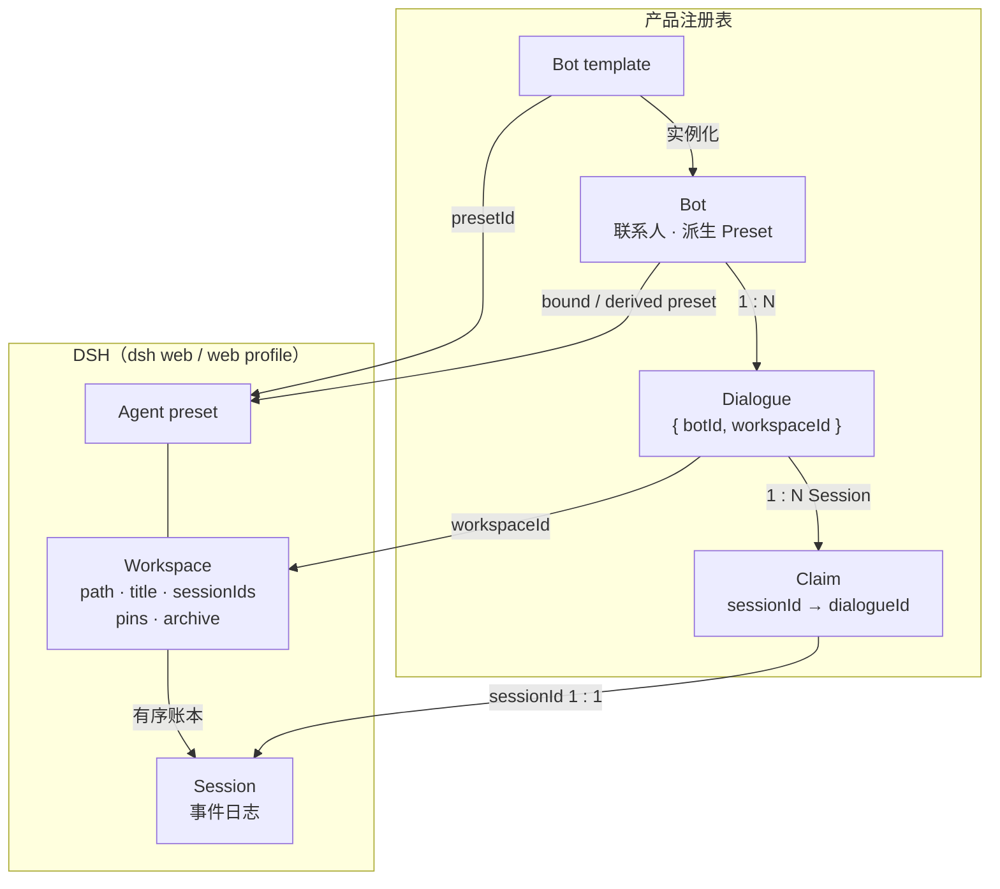
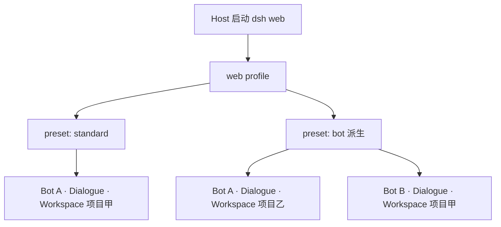
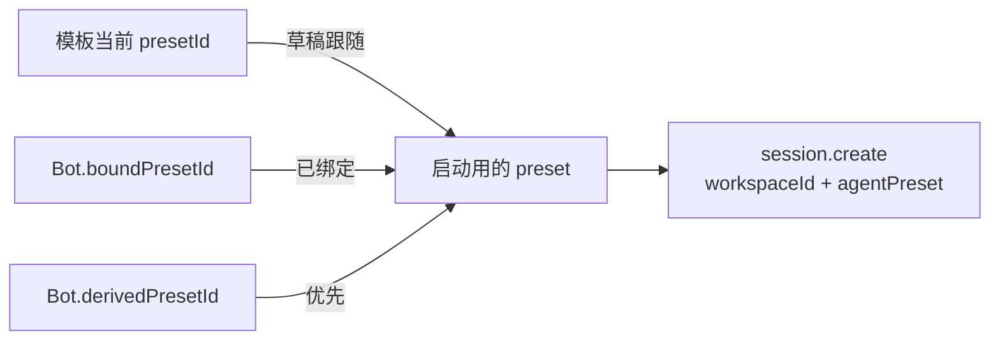
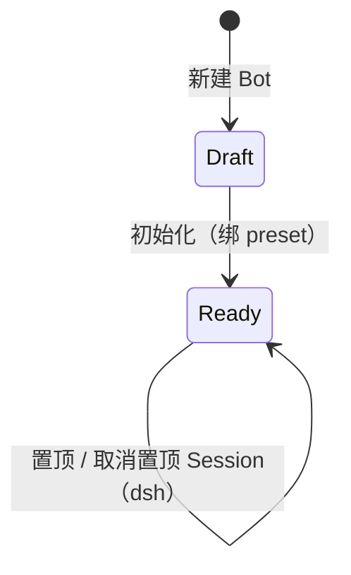
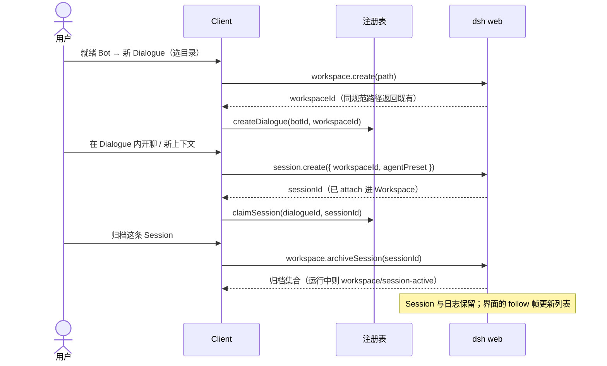
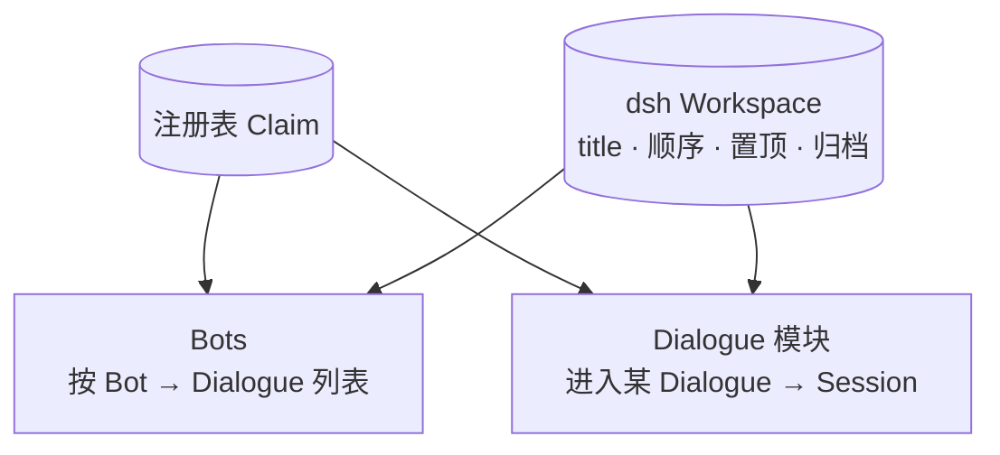

# Bot · Dialogue · Session · DSH 映射

对象边界与所有权对照。原则见 [BLUEPRINT](BLUEPRINT.md)，决定见 [ADR 0001](adr/0001-bot-has-many-sessions.md)、[ADR 0005](adr/0005-dialogue-on-dsh-workspace.md) 与 [ADR 0006](adr/0006-lorca-style-bot-app.md)，用词见根 [GLOSSARY](../GLOSSARY.md)。

> **修订（ADR 0006）**：目标形态是**一个 Bot 一条长对话**，段（Session）可以落在不同的 dsh Workspace；本文的 **Dialogue 层是 L1 的过渡数据模型**（注册表 v5），L2 把认领从 Dialogue 改成 Bot 并迁移 v5 数据。界面在 L1 对一个 Bot 只显示它最近的一条 Session。

## 一图总览

要点：

| 产品             | DSH                              | 关系                                                               |
| ---------------- | -------------------------------- | ------------------------------------------------------------------ |
| Bot template     | Agent preset id                  | 模板映射 preset；非正文快照                                        |
| Bot              | 共用 `web` profile 上启动 preset | 能力 = preset（`plugins`：指令、工具、skills、可选 MCP…）          |
| Dialogue         | **一个 Workspace 的一个视角**    | L1 过渡：`workspaceId`；L2 改成段直接引用 Workspace                 |
| Session / 会话   | 一条 Harness Session             | 严格一对一；一个上下文场景                                         |
| Claim            | Session 认领到 Dialogue          | 写在注册表；日志仍在 dsh                                           |
| Dialogue 名      | Workspace `title`                | 重命名 = `workspace.rename`；同一 Workspace 上共享                 |
| Session 归档     | Workspace `archived set`         | 运行中被 `workspace/session-active` 拒绝，可 `stopActivity`        |
| 置顶             | Workspace `pinned sessionIds`    | 最近置顶在前；L1 的界面不再显示段级置顶                            |
| Session 顺序     | Workspace `sessionIds`           | 新建前插、手动重排；顺序归 dsh                                     |
| Deliverable      | DSH Deliverable                  | 投影某 Session 场景内交付物；Dialogue 可累积多个                   |
| （无）           | 未认领 Session                   | 不进入产品列表                                                     |

基数：**Bot 1—N Dialogue**；**Workspace 1—N Dialogue**（同一 Bot 对同一 Workspace 只开一段）；**Dialogue 1—N Session**。

## Profile 与 Preset

|            | **Profile**                         | **Agent preset**                                             |
| ---------- | ----------------------------------- | ------------------------------------------------------------ |
| 是什么     | 一次 `dsh` 进程的装配单元           | 该进程里某个 Agent 的子插件组合（`id` + `plugins`）          |
| MyAid 用法 | 全体 Bot **共用**官方 `web` profile | 每个 Bot 一个 preset id（模板绑定或派生）                    |
| 数量       | 一个本机执行面、一个 profile        | 同一 profile 上可有多个 preset                               |
| 谁持有正文 | profile 装配在 dsh / Host           | profile preset 在 dsh；Bot 派生 preset 在插件；注册表只存 id |

- **不**按 Bot 拆 profile 或 dsh 进程。
- Bot 差异落在 **preset**；项目/目录差异落在 **Workspace / Dialogue**。
- 产品口语 **Runner** = 本机 `dsh web` / web profile，**不是** DSH 专名。

## 身份与能力

- 能力、默认模型属于 **Bot**（preset）。
- **Workspace** 属于 dsh；Dialogue 只持有它的 id。`session.create` 用 `workspaceId`（dsh 解析 cwd、建好后 attach），不再传 cwd。
- 改能力：更新派生 preset；正在跑的一轮不打断。派生正文由 `myaid-plugin-bot-presets` 拥有并注册进官方 registry；改完后**新建**的 Session 用新组合，已存在的 Session 保留它已持有的组合。

## 认领与生命周期

## 两个视图

- 新建 Dialogue / Session 只挂在某个就绪 Bot 上。
- 未认领 Session 不展示；被 dsh 归档的 Session 也不展示（Dialogue 面板留「已归档」入口可 Unarchive）。会话全部归档的 Dialogue 从 Bots 与 Dialogues 的活跃列表落进 Dialogues 分区的「已归档」组。

## 真源分工

| 真源       | 持有                                                                                                                 |
| ---------- | -------------------------------------------------------------------------------------------------------------------- |
| dsh        | Session 日志与执行状态、Workspace（path / title / 顺序 / 置顶 / 归档）、preset 正文、凭据、Deliverable 相关事件/摘要 |
| 桌面注册表 | Bot、Dialogue（botId + workspaceId）、Claim、模板引用、模型偏好、Bot 默认工作区                                      |
| 客户端偏好 | Navigator 宽度 / 折叠、Workbench 布局、非 Session 的 Favorites 地址                                                  |
| 插件       | 派生 preset 正文与技能副本（`myaid-plugin-bot-presets`，`$DSH_HOME`）                                                |
| Host       | dsh 生命周期与连接发现；不写业务 Dialogue/Session 权威                                                               |

## 执行占用（按 Workspace）

同一 **Workspace** 同时只有一条 Session 可执行；其它 Session 可看历史 / 可新建，开始执行须等占用释放。不同 Workspace 的 Dialogue 可以各跑一条。两个 Bot 看同一目录即同一 Workspace，因此它们在该目录上互斥。
