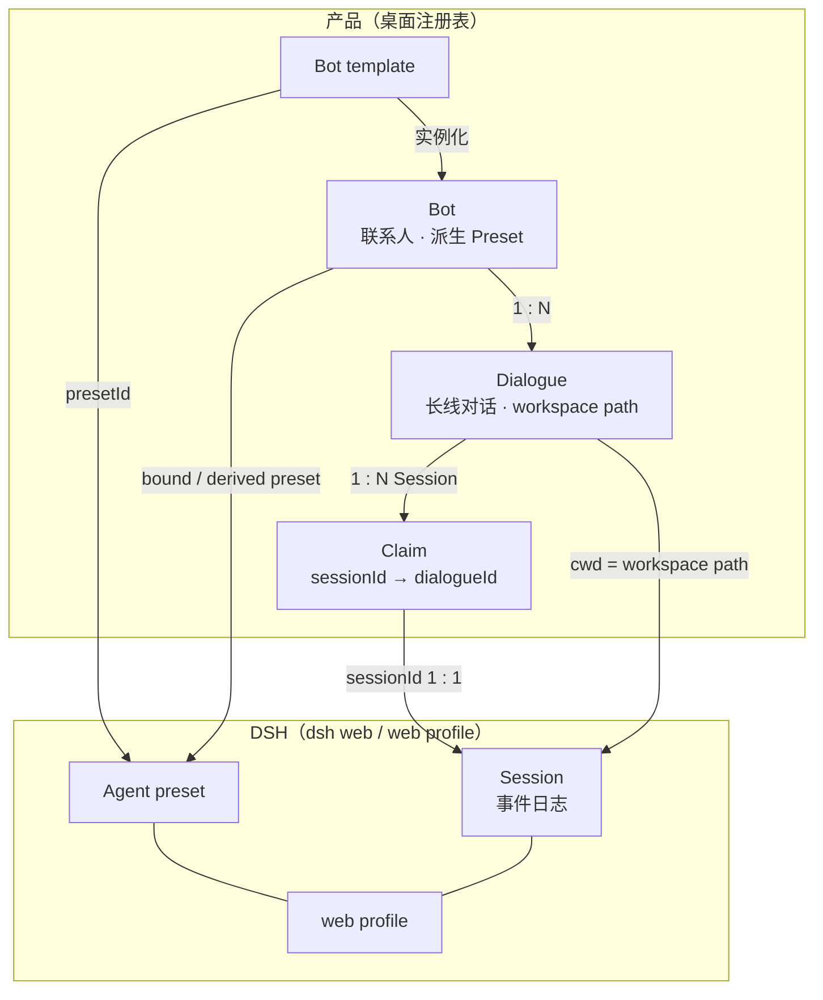
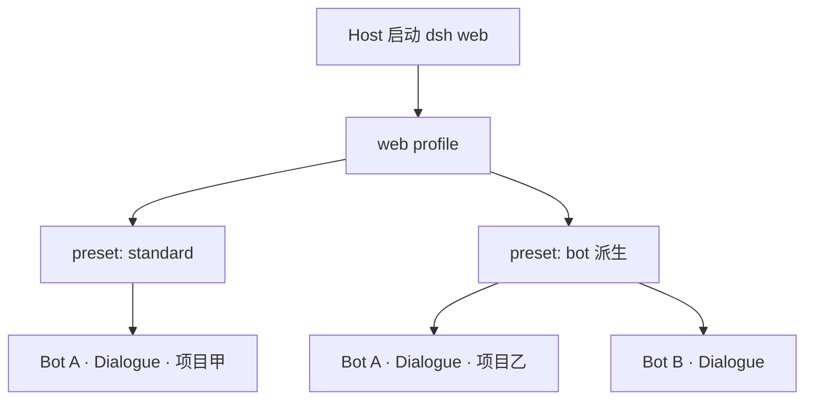
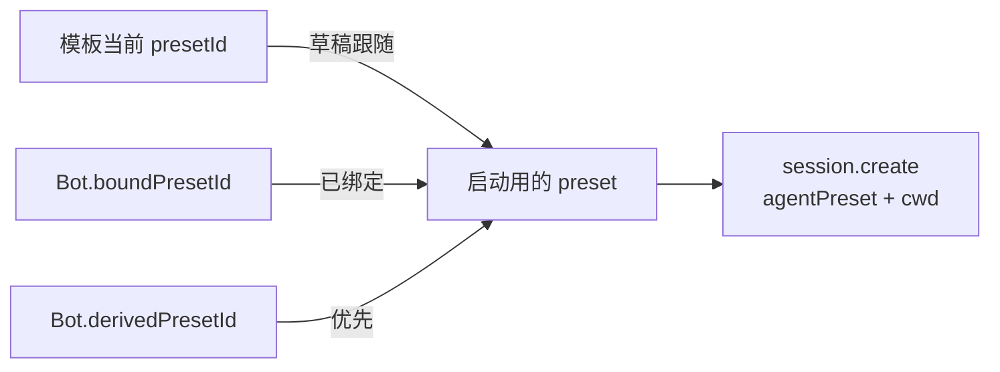
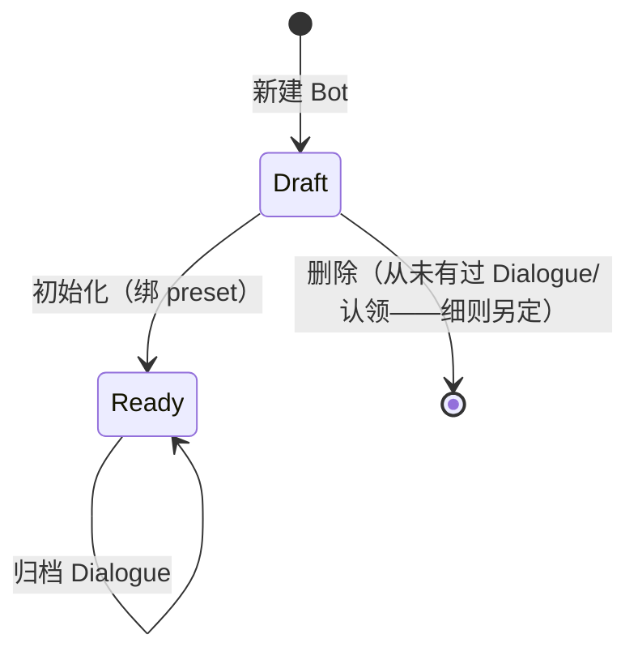
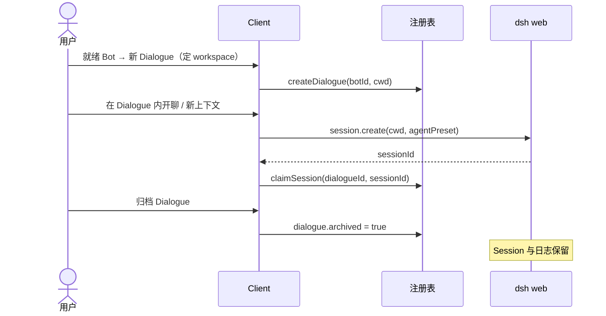
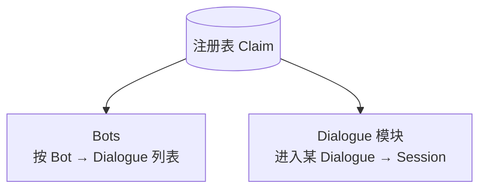

# Bot · Dialogue · Session · DSH 映射

对象边界与所有权对照。原则见 [BLUEPRINT](BLUEPRINT.md)，决定见 [ADR 0001](adr/0001-bot-has-many-sessions.md)，用词见根 [GLOSSARY](../GLOSSARY.md)。

## 一图总览

要点：

| 产品           | DSH                                    | 关系                                                      |
| -------------- | -------------------------------------- | --------------------------------------------------------- |
| Bot template   | Agent preset id                        | 模板映射 preset；非正文快照                               |
| Bot            | 共用 `web` profile 上的一个启动 preset | 能力 = preset（`plugins`：指令、工具、skills、可选 MCP…） |
| Dialogue       | （无同名对象）                         | 产品聚合；绑 workspace path；下挂多条 Session             |
| Session / 会话 | 一条 Harness Session                   | 严格一对一；一个上下文场景                                |
| Claim          | Session id 归属 Dialogue               | 写在注册表；日志仍在 dsh                                  |
| Deliverable    | DSH Deliverable                        | 投影某 Session 场景内交付物；Dialogue 可累积多个          |
| （无）         | 未认领 Session                         | 不进入产品列表                                            |

基数：**Bot 1—N Dialogue 1—N Session**。

## Profile 与 Preset

|            | **Profile**                         | **Agent preset**                                    |
| ---------- | ----------------------------------- | --------------------------------------------------- |
| 是什么     | 一次 `dsh` 进程的装配单元           | 该进程里某个 Agent 的子插件组合（`id` + `plugins`） |
| MyAid 用法 | 全体 Bot **共用**官方 `web` profile | 每个 Bot 一个 preset id（模板绑定或派生）           |
| 数量       | 一个本机执行面、一个 profile        | 同一 profile 上可有多个 preset                      |
| 谁持有正文 | profile 装配在 dsh / Host           | preset 正文在 dsh；注册表只存 id                    |

- **不**按 Bot 拆 profile 或 dsh 进程。
- Bot 差异落在 **preset**；项目/目录差异落在 **Dialogue.workspace path**。
- 产品口语 **Runner** = 本机 `dsh web` / web profile，**不是** DSH 专名。

## 身份与能力

- 能力、默认模型属于 **Bot**（preset）。
- **workspace path** 属于 **Dialogue**；`session.create` 的 cwd 取自当前 Dialogue。
- 改能力：更新派生 preset；正在跑的一轮不打断；空闲后按 DSH 规则用新 preset 恢复或新开 Session。

## 认领与生命周期

## 两个视图

- 新建 Dialogue / Session 只挂在某个就绪 Bot 上。
- 未认领 Session 不展示。

## 真源分工

| 真源       | 持有                                                                 |
| ---------- | -------------------------------------------------------------------- |
| 桌面注册表 | Bot、Dialogue、Claim、模板引用、模型偏好、workspace path             |
| dsh        | Session 日志、执行状态、preset 正文、凭据、Deliverable 相关事件/摘要 |
| Host       | dsh 生命周期与连接发现；不写业务 Dialogue/Session 权威               |

## 执行占用（按工作区路径）

同一绝对 **workspace path** 同时只有一条 Session 可执行；其它 Session 可看历史 / 可新建，开始执行须等占用释放。路径不同的 Dialogue 可以各跑一条。产品不要求路径在 Bot 之间唯一。
