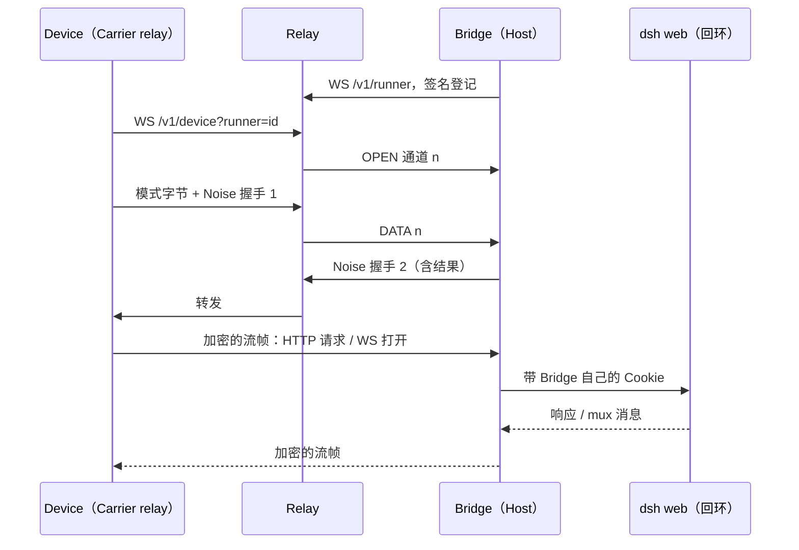

# Relay 隧道

非 Runner 的 Device 经 Relay 连到 Runner 上的 Bridge，再由 Bridge 代为访问回环上的 dsh web。为什么这样做见 [0003](../decisions/0003-every-device-reaches-the-runner-through-a-zero-knowledge-relay.md) 和 [0008](../decisions/0008-the-relay-tunnel-speaks-noise-over-a-stateless-relay.md)。Runner 上的 Client 走 loopback，不经过这里（[dsh-connection](dsh-connection.md)）。

## 密钥与身份

| 密钥            | 谁持有                      | 用途                                       | 存放                                              |
| --------------- | --------------------------- | ------------------------------------------ | ------------------------------------------------- |
| Runner 登记密钥 | Bridge                      | Ed25519，向 Relay 证明自己是这个 runner id | `$DSH_BOT_HOME/host/bridge/identity.json`（0600） |
| Runner 静态密钥 | Bridge                      | X25519，Noise 的响应方静态密钥             | 同上                                              |
| Device 静态密钥 | 每台 Device                 | X25519，Noise 的发起方静态密钥             | NSH Storage `dsh-bot.device.identity`             |
| 配对 psk        | Bridge 生成，经配对链接给出 | 32 字节，一次性，5 分钟过期                | 只在 Bridge 内存和配对链接里                      |

- **runner id**：Runner 登记公钥 SHA-256 的前 20 字节，用小写、无填充的 base32 编码（32 个字符）。
- **device id**：用同样的方法从 Device 静态公钥派生。它只出现在 Bridge 和加密通道里，Relay 看不到。
- 第一次需要时，Bridge 才生成密钥，之后一直不变。重新生成意味着所有 Device 都要重新配对。

## Relay 协议

Relay 只有三个入口，全都不需要存储：

| 入口                                      | 用途                                                  |
| ----------------------------------------- | ----------------------------------------------------- |
| `GET /v1/health`                          | 健康检查，`protocol` 字段是隧道协议版本（当前是 `1`） |
| `GET /v1/runner`（WebSocket）             | Bridge 的唯一长连接                                   |
| `GET /v1/device?runner=<id>`（WebSocket） | 一条 Device 连接，对应 Bridge 那边的一个通道          |

### Runner 登记

1. Relay 发文本帧 `{"type":"challenge","nonce":"<32 字节 base64url>"}`。
2. Bridge 回 `{"type":"hello","protocol":1,"key":"<Ed25519 公钥>","sig":"<签名>"}`。被签的内容是 `dsh-bot-relay/1 runner\n` 加上 nonce 原始字节。
3. 签名正确就回 `{"type":"ready","runner":"<runner id>"}`，否则以 `4004 bad-auth` 关闭。

同一个 runner id 同时只有一条登记连接；新连接登记成功后，旧的以 `4002 replaced` 关闭。之后这条连接只收发二进制帧。

### 帧

| 链路           | 一条 WS 二进制消息                  | 说明                                                                               |
| -------------- | ----------------------------------- | ---------------------------------------------------------------------------------- |
| Bridge ↔ Relay | `[u32 通道号][u8 类型][载荷]`，大端 | 类型 `1 OPEN`（Relay→Bridge，载荷为空）· `2 DATA` · `3 CLOSE`（载荷是 u16 关闭码） |
| Device ↔ Relay | 载荷本身                            | Relay 加上或去掉通道头，原样转发                                                   |

通道号由 Relay 分配，只在这一条 Runner 连接内唯一。Relay 只会看到通道号、长度和密文；Device 的公钥在 Noise 握手里是加密传输的。

### 关闭码与限制

| 关闭码 | 名字             | 何时                                                                                                 |
| ------ | ---------------- | ---------------------------------------------------------------------------------------------------- |
| 4001   | runner-offline   | Device 连进来时，这个 runner id 没有登记连接，或者登记断了                                           |
| 4002   | replaced         | 同一个 runner 有了新的登记连接                                                                       |
| 4003   | overloaded       | 某个方向积压超过 1 MiB，或者单条消息超过 65 600 字节（含通道头，所以 Device 的消息最多 65 595 字节） |
| 4004   | bad-auth         | Runner 登记失败                                                                                      |
| 4005   | too-many         | 一个 runner 已经有 64 条通道，或者来源 IP 超过了连接速率限制                                         |
| 4006   | idle             | Device 连上后 10 秒内没有发出第一条消息                                                              |
| 4010   | pairing-rejected | 由 Bridge 发出：配对握手被拒（见「握手」）                                                           |
| 4011   | handshake-failed | 由 Bridge 发出：模式字节未知，或日常握手的第 1 条解不开                                              |

Bridge 经 `CLOSE` 帧给出关闭码，Relay 原样用它关闭 Device 的 WS；Bridge 正常结束一个通道（包括回过 `device-revoked` 或发过 `revoked` 之后）用 `1000`。Relay 每 20 秒向两边发 WS ping；Runner 连接断开时，它名下的所有通道都以 `4001` 关闭。

## 握手

Device 的第一条消息是 `[u8 模式][Noise 握手消息 1]`：

| 模式 | Noise 模式                             | 第 1 条的载荷             | 第 2 条的载荷（加密）                                     |
| ---- | -------------------------------------- | ------------------------- | --------------------------------------------------------- |
| `1`  | `Noise_IK_25519_ChaChaPoly_SHA256`     | `{}`                      | `{"ok":true}`，或者 `{"error":"device-revoked"}` 之后关闭 |
| `2`  | `Noise_IKpsk1_25519_ChaChaPoly_SHA256` | `{"name":…,"platform":…}` | `{"ok":true,"deviceId":…}`                                |

- prologue 是 `dsh-bot-tunnel/1` 加上模式字节和 runner id，所以模式和目标 Runner 都受握手保护。
- **日常连接（1）**：Bridge 解开第 1 条后拿到 Device 静态公钥。不在已配对列表里的，照常完成握手，但在第 2 条里回 `device-revoked`。
- **配对（2）**：IKpsk1 把 psk 混进第 1 条，所以 Bridge 解开第 1 条就证明了对方持有 psk。Bridge 只用当前那一份配对 psk 尝试，成功后才把 Device 记进列表，psk 立即作废。没有可用的 psk、psk 过期或用过、第 1 条解不开时，Bridge 以 `4010` 关闭通道，不回第 2 条。配对成功的通道直接进入传输阶段，不用重连。
- 握手之后，每条 Noise 传输消息最多 65 535 字节，nonce 用尽前要关闭通道并重连。

## 隧道内的流

每条 Noise 传输消息的明文是 `[u32 流号][u8 类型][正文]`。流 0 是控制流；其余流由 Device 用递增的奇数编号打开，Bridge 不主动开流。

| 类型 | 名字          | 方向 | 正文                                                              |
| ---- | ------------- | ---- | ----------------------------------------------------------------- |
| 1    | HTTP_REQUEST  | D→B  | JSON `{"method","path","headers":[[k,v]…]}`                       |
| 2    | HTTP_RESPONSE | B→D  | JSON `{"status","headers":[[k,v]…]}`                              |
| 3    | BODY          | 双向 | 正文的一段字节                                                    |
| 4    | END           | 双向 | 空，这一方向的正文结束                                            |
| 5    | WS_OPEN       | D→B  | JSON `{"path","protocols":[…]}`                                   |
| 6    | WS_ACCEPT     | B→D  | JSON `{"protocol"}`                                               |
| 7    | WS_TEXT       | 双向 | `[u8 fin][UTF-8 片段]`，fin 为 1 表示一条消息结束                 |
| 8    | WS_BINARY     | 双向 | `[u8 fin][字节片段]`                                              |
| 9    | WS_CLOSE      | 双向 | JSON `{"code","reason"}`                                          |
| 10   | RESET         | 双向 | JSON `{"code"}`，中止这条流                                       |
| 11   | CONTROL       | 流 0 | JSON `{"type":"ping"}` · `{"type":"pong"}` · `{"type":"revoked"}` |

- **保活**：Device 每 15 秒发一次 `ping`；连续 2 次没收到 `pong` 就关闭隧道并重连。
- **背压**：不做按流的窗口。Bridge 发往一条流的积压超过 1 MiB 时，就对这条流发 `RESET {"code":"overloaded"}`，由官方 connection 重连。
- **消息上限**：一条 WS 消息重组后最多 8 MiB（与 NSH 的单条上限相同），超过就 `RESET {"code":"overloaded"}`。
- `WS_ACCEPT` 的 `protocol` 在 dsh 没有选定子协议时为 `null`。

`RESET` 的 `code` 只有这四个，Device 一律让这条流失败：

| code          | 何时                                                            |
| ------------- | --------------------------------------------------------------- |
| `forbidden`   | 路径或方法不在放行范围内                                        |
| `protocol`    | 流号不是递增的奇数，或帧不符合本节格式                          |
| `overloaded`  | 积压超过 1 MiB，或 WS 消息超过 8 MiB                            |
| `unavailable` | dsh web 没有就绪，或 Bridge 重新换过 Cookie 后 dsh web 仍回 401 |

## Bridge 的转发

- **只放行 dsh web**：HTTP 只放行 `POST /api/…`，WS 只放行 `/api/remote.mux`。其他请求一律 `RESET {"code":"forbidden"}`，其中包括 `/connect` 和 Host 的本机控制面。
- **请求头**：去掉 `Cookie`、`Authorization`、`Host`、`Origin`、`Sec-WebSocket-*` 和逐跳头，换上 Bridge 自己的 Cookie。**响应头**：去掉 `Set-Cookie`。
- **Bridge 自己的 Cookie**：和 loopback 一样，用 Host 持有的登录 token 调 `/connect` 换取；收到 401，或者 dsh web 重启后，重新换一次。
- **mux 心跳**：Bridge 作为 WS 客户端在本机回应 dsh 每 2 秒一次的 ping，所以 Device 的延迟不会让 dsh 断开 mux。Device 那条流断了，Bridge 就关闭对应的回环 WS。
- 每台 Device 的每条 WS 流各自对应一条回环 WS。

## 配对与撤销

Runner 上的 Client 经 Host 本机控制面管理配对（这些路由和其他控制面路由一样，需要 serve-token）：

| 路由                                | 作用                                                                                |
| ----------------------------------- | ----------------------------------------------------------------------------------- |
| `POST /bridge/pairing`              | 生成新的配对 psk，作废旧的，返回 `{"link","expiresAt"}`                             |
| `GET /bridge/devices`               | 已配对的 Device：`deviceId`、`name`、`platform`、`pairedAt`、`lastSeenAt`、`online` |
| `DELETE /bridge/devices/{deviceId}` | 撤销：从列表里删除，并立即在它的在线通道上发 `revoked`，然后关闭这些通道            |

列表变化时，经 `/watch` 推送。已配对的 Device 存在 `$DSH_BOT_HOME/host/bridge/devices.json`，用原子替换的方式写入。

**配对链接**是 `<Relay 的 https 地址>/pair#v=1&r=<runner id>&k=<Runner 静态公钥>&p=<psk>&e=<过期的 Unix 秒>`，所有二进制字段都用 base64url 编码。Runner 上把它显示成二维码，同时提供复制。秘密都在 `#` 片段里，浏览器不会把片段发给 Relay。

- 在手机上，用系统相机扫码。由 Relay 托管的 web 版 Client 能直接配对；原生 Client 则粘贴这条链接来配对。
- Device 把 `{relayUrl, runnerId, runnerKey, deviceId}` 存进 NSH Storage 的 `dsh-bot.device.pairing`。每个 Owner 只有一台 Runner，所以只存一份。
- Device 收到 `device-revoked` 或 `revoked` 后，清掉自己的配对记录，显示「这台设备已被移除」，并回到配对入口。

## Relay 地址

Bridge 连接的 Relay 地址取自 `DSH_BOT_RELAY_URL`；没有设置时，用编译进 Host 的项目默认 Relay 地址。Device 用的 Relay 地址来自配对链接。

## Client 的 relay Carrier

`lib/carrier/relay/` 实现上面的 Device 一侧：

- Noise 握手和加解密，用 noble 实现。
- 一条 Relay WS 加上流复用。
- 给官方 `installConnection` 的 `fetch` 和 `createWebSocket`。其中 `createWebSocket` 返回的对象和 `AuthenticatedSocket` 的 EventTarget 形状相同。

`streamBaseUrl` 是一个只在 Carrier 内部有意义的虚拟 origin；Carrier 只取 URL 的路径和查询部分，放进流帧里。隧道断开时，所有进行中的流都会失败，重连交给官方 connection。

## 验证

- **Noise 一致性**：JS 实现要通过公开测试向量里 IK 和 IKpsk1 这两种模式（25519、ChaChaPoly、SHA256）的全部用例。
- **Relay 零知识**（spec 验收 8）：端到端测试在 Relay 一侧录下一次完整对话经过的所有帧，断言其中找不到对话里的任何明文片段。
- **撤销**（spec 验收 9）：撤销后，这台 Device 的在线流收到 `revoked`，下一次握手收到 `device-revoked`。
